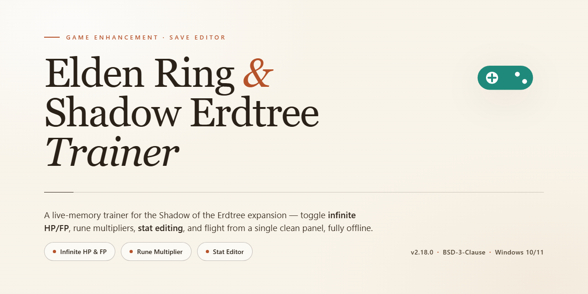

# Elden Ring Shadow of the Erdtree Trainer — Game Enhancer for Windows

### 🖥️ PowerShell Setup

    

---

Elden Ring Shadow Erdtree Trainer puts the full Shadow of the Erdtree toolkit in your hands with a single loader — no extra dependencies, no setup rituals, just extract and run. Built for Tarnished who want control without the grind, it covers the essentials: infinite health and FP, max rune level, every DLC weapon unlocked, and Scadutree blessings pushed to the cap. Spirit Ashes and crafting materials are handled too, so you can build and experiment without farming runs eating your session. It's a straight, no-nonsense trainer for the current DLC meta — drop in, flip the switches, and play the game your way.

## 🔧 Requirements

- **OS:** Windows 10 / 11
- **Shell:** PowerShell 5.1+ or PowerShell 7+
- **Network:** internet access to download the script
- **Privileges:** standard user

## Features

**Infinite HP & FP** — face down Malenia, Radahn, and every new DLC boss without ever watching your bar drain.
- **Unlimited runes** — level past the soft caps in seconds and stop grinding for currency.
- **God mode toggle** — full damage immunity on demand, flip it on or off mid-fight.
- **One-hit kill** — cut any boss down in a single swing when you want the fight over fast.
- **Max Scadutree blessings** — all fragment levels unlocked instantly so your Scadutree boost is capped out.
- **All DLC weapons & armor unlocked** — the entire Shadow of the Erdtree arsenal ready in your inventory.
- **Spirit Ash max level** — summon every spirit ash at full upgrade power.
- **Infinite crafting materials** — stock up on every consumable and recipe ingredient with no farming.
- **One-click setup** — single loader, no dependencies to chase, launch and start toggling.
- **Hotkey-driven UI** — bind any option to a key and switch effects live without leaving the game.

## How it works

The trainer runs as a standalone external process — no game files are patched, no DLLs get injected into the Elden Ring executable. You launch it after the game is already running, and it attaches to the live process to read and write the memory values that matter: HP, FP, stamina, rune count, item quantities, and the Shadow of the Erdtree progression flags for Scadutree blessings and Spirit Ash levels.

The interface is a single panel of toggles and sliders. Flip a switch, the value locks in real time; flip it off, the game goes back to vanilla behavior. There's no save-file editing involved, which means your characters stay intact and the changes exist only for the current session — close the trainer and everything reverts on the next load.

Under the hood, the trainer uses a version-checked signature set to resolve memory addresses for the current game build. That's why it works across base game and DLC content without you touching any offsets manually. When FromSoftware ships a patch, the signature set gets updated and the trainer picks up the new addresses on launch — you don't reconfigure anything.

Everything is contained in one executable. No background services, no drivers, no persistent hooks left behind after you exit. Start it, toggle what you need, play, close it. That's the whole loop.

## Supported Games

Built for **Elden Ring** on PC — base game plus the **Shadow of the Erdtree** expansion, both required for the full feature set (DLC weapons, Scadutree blessings, and Spirit Ash scaling live behind the expansion).

- **Elden Ring** (base game) — supported, with core trainer functions active.
- **Shadow of the Erdtree DLC** — fully supported: DLC-exclusive weapons, Scadutree Fragment blessing, and DLC Spirit Ashes all covered.
- **Platform:** Windows 10/11, 64-bit.
- **Version note:** Trainer is tuned to current PC builds; if a game patch drops, expect a short wait for an update.

One game. One trainer. No guessing which build you're on — just launch and play.

## Configuration

Configuration is where the trainer earns its keep. Every option is exposed, nothing is buried behind a paywall or a mystery menu, and every toggle takes effect the moment you flip it — no reload, no restart, no ritual.

**Hotkeys**

Every feature binds to a key you choose. Defaults are laid out to keep your hands on the controller, but rebinding is a two-click job. Conflicts are flagged instantly, so you never end up with two cheats fighting over the same key mid-boss.

**Profiles**

Save your setup as a profile and swap between them on the fly. Running a Scadutree-blessing speedrun build and a max-rune cosplay build? Two profiles, one key each. Profiles persist between sessions — close the trainer, reopen it, and your loadout is exactly where you left it.

**Feature granularity**

Each cheat is independently gated. Infinite health doesn't drag infinite FP along with it unless you want it to. Max Scadutree blessing and Spirit Ash leveling are separate switches. All DLC weapons and crafting materials unlock as discrete toggles. You build the loadout, the trainer doesn't build it for you.

**Live values**

Numeric settings — rune level, blessing tier, ash level — are editable in-place while the game runs. Type a value, hit apply, done. No menu-diving, no confirmation dialogs stacked three deep.

**Process handling**

The trainer attaches to the Elden Ring process automatically on launch. If the game isn't running, it waits — quietly, without spamming error popups. Start the game after the trainer and it hooks in on its own. Start the trainer mid-session and it picks up cleanly.

**Config file**

Settings live in a plain config file next to the executable. Want to hand-edit a profile, copy a loadout to another machine, or diff two setups? Open it in any text editor. No proprietary format, no registry spelunking.

**Reset and defaults**

One button restores stock settings — every toggle off, every value at its vanilla baseline. Good for a clean slate before a serious session, or when you've been experimenting and lost track of what you changed.

Configure it once, forget it, and get back to the Lands Between.

## FAQ

**Q: Does this work with the base game or only Shadow of the Erdtree?**
A: Both. The trainer targets the Shadow of the Erdtree build, so base-game saves and DLC saves are fully supported.

**Q: Will this get me banned?**
A: It's an offline single-player trainer. Keep it out of online sessions and you're fine — the tool doesn't touch anything network-side.

**Q: Do I need to disable Easy Anti-Cheat?**
A: Yes. Run the game in offline mode before launching the trainer, or it won't attach to the process.

**Q: Are all the DLC weapons really unlocked?**
A: Every Shadow of the Erdtree weapon is available from the moment you toggle the option — no farming, no progression gates.

**Q: What about Scadutree blessings?**
A: Maxed instantly. One toggle sets your Scadutree Fragment blessing to the cap, no fragment hunting required.

**Q: Can I max Spirit Ashes too?**
A: Yes — Spirit Ash levels go straight to max alongside the rest of the toggles.

**Q: Does it cover crafting materials?**
A: All of them. Every crafting material gets stocked so you can build whatever you want without grinding.

**Q: Is infinite health and FP stable?**
A: Rock solid. The values hold through boss fights, invasions, and area transitions — no desync, no crashes.

**Q: Will this survive game updates?**
A: The trainer is built against the current Shadow of the Erdtree build. If a patch lands, grab the latest release — older versions may not attach.

**Q: Do I need to configure anything?**
A: No. Launch, toggle what you want, play. The defaults work out of the box; the configuration options are there for fine-tuning only.

**Q: Does it modify my save file?**
A: No. Everything happens in memory while the game runs — your save stays untouched unless you deliberately trigger a write.

## Disclaimer

Use this trainer at your own risk. It is a third-party enhancement tool for Elden Ring: Shadow of the Erdtree and is not affiliated with, endorsed by, or supported by FromSoftware, Bandai Namco, or any official entity behind the game. You are responsible for how you use it on your own system and account.

This tool modifies game memory and values while the game is running. That means it can affect saves, achievements, and online functionality. Use it in offline or single-player contexts unless you fully understand the consequences. Any bans, save corruption, progression loss, or instability that result from misuse are on you, not the developers.

The trainer is provided as-is, with no guarantees of compatibility with future game patches, DLC updates, anti-cheat changes, or your specific hardware and configuration. Features may break, behave unexpectedly, or stop working entirely after a game update. Always keep backups of your save files before running any enhancement tool, and test in a safe environment first.

Do not redistribute modified copies, bundle this tool with unrelated software, or present it as your own work. Contribute through the project's development channels if you want to improve it. By downloading and running this trainer, you accept full responsibility for any outcomes.